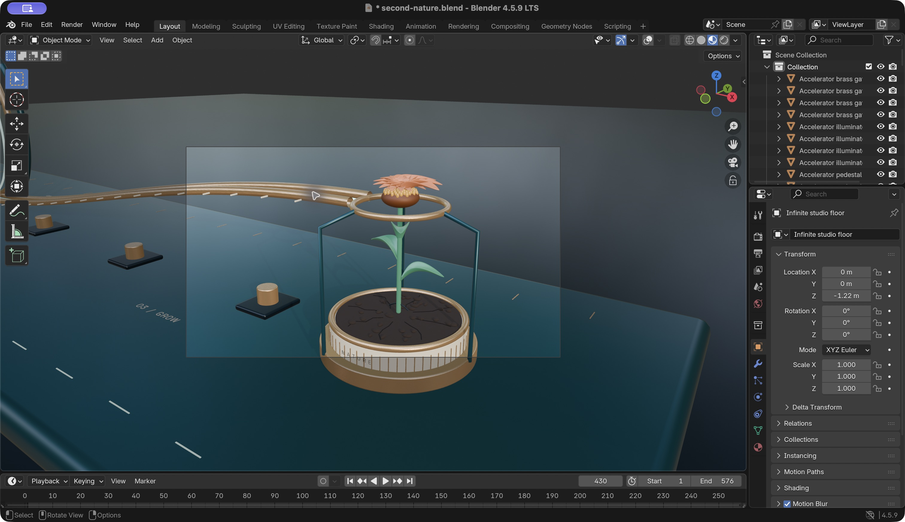

# SECOND NATURE

**Make every second grow.**

A 24-second procedural Blender film by **Shivam Gupta**, created for the RenderJuice Speed contest. A single luminous drop races through a precision machine to a dry seed. Acceleration gives way to a held breath, a fall, and a flower.


[Watch the complete 1080p film](film/second-nature.mp4) · [Blender source](film/second-nature.blend) · [Entry text and disclosures](docs/ENTRY.md) · [Optional narration](docs/NARRATION.md)

The film is the entry. The accompanying **local production studio** makes it repeatable: sign in, create a palette variant, build a scene, resume a render, and assemble a finished movie. No paid service or API key is required. It is a creator workstation tool; a hosted multi-tenant service is a future product, not a claim about this release.

## Start the studio

On this Mac, double-click **start-studio.command**, or run:

```sh
python3 -m venv .venv
.venv/bin/python -m pip install -r requirements.txt
.venv/bin/python studio/server.py
```

Open **http://127.0.0.1:8765**. Create a local account with a password of at least 12 characters. There is no default account, no email verification, and no external identity provider. Your local studio account is separate from RenderJuice and Discord.

Blender **4.5 LTS** and **FFmpeg** must be installed to produce variants. The current workspace has a portable Blender 4.5.9 and FFmpeg ready. On another computer, [install Blender](https://www.blender.org/download/lts/4-5/) and [FFmpeg](https://ffmpeg.org/download.html), then set `BLENDER_BIN` if Blender is not on PATH:

```sh
export BLENDER_BIN='/Applications/Blender.app/Contents/MacOS/Blender'
```

Python 3.10+ is recommended. NumPy and Pillow are used only for original sound synthesis and pixel-precise typography; the studio itself uses Python's standard library. Nothing sends production files to the cloud.

## Produce a film from the command line

```sh
.venv/bin/python pipeline.py build --config project.json
.venv/bin/python pipeline.py render --config project.json --profile preview
.venv/bin/python pipeline.py assemble --config project.json
```

Use `--profile final` for 1920 × 1080, 48-sample Cycles output. Preview uses 960 × 540 and 16 samples. Both profiles contain **576 frames at 24 fps, exactly 24 seconds**. A Metal, OptiX, CUDA, HIP or oneAPI device is selected when available, with a CPU fallback.

A complete run is `pipeline.py all --config project.json --profile final`. For a short installation check, render `--start 1 --end 3`; assembly intentionally refuses incomplete sequences. `pipeline.py verify --config project.json` checks the built scene identity and all frames.

Edit `project.json` to change `seed`, `hero_color` or `accent_color`. An optional absolute `output_dir` chooses the destination; otherwise output goes to `film/`. The seed changes the soil dressing; the palette changes the hero and enamel. Story, duration, typography and camera edit are intentionally art directed and fixed in this release. The studio writes each variant into its own `projects/<id>/` directory.

## Recovery and correctness

- Frame files are written atomically. Resume checks dimensions, chunk CRCs and complete PNG structure; corrupt frames are rendered again.
- Cache identity includes the configuration, geometry source, renderer source, saved Blender file and quality profile. Changes cannot silently mix old and new renders.
- Switching profiles archives the previous frame folder. Rebuild after editing the scene source or a saved Blender project. Manual scene edits are deliberately rejected for deterministic resume.
- One operation holds a lock per output folder. The studio additionally limits the workstation to one active job. Stop with Ctrl-C or Cancel; restart the same render to continue.
- Camera shots have independent baked animation, preventing camera teleports from contaminating motion blur at cuts. Animation plays without Python autorun, and the font is packed into the `.blend`.
- The MP4 uses H.264/yuv420p, AAC stereo at 48 kHz, and fast-start metadata. FFmpeg normalizes delivery audio to a -16 LUFS target and -1.5 dB true peak limit.

Detailed build, render and assembly logs stay beside the project. Do not remove `build-manifest.json` or `render-state.json` while resuming. Source hashes and Blender's file hash protect cache identity; they are not a claim that different GPU vendors produce byte-identical pixels.

## Craft and evidence

Everything visible was built through `bpy`: analytic droplet mesh, beveled rails and gates, loop calibration ticks, machined planter, dry soil, seed, curved petals, leaves and Fibonacci pollen. The flower uses separate hinged whorls with staggered unfolding and settling. Motion is scripted keyframe animation, **not a physical simulation**.

The soundtrack is original mathematical synthesis with no recorded samples. Typography uses the bundled **Space Grotesk** font under SIL OFL 1.1. No stock models, image textures, music, or generative video appear in the film.



AI assistance: OpenAI Codex helped with concept development, code, production automation, documentation and review. Shivam Gupta is the entrant and project lead. See [full disclosure and entry copy](docs/ENTRY.md).

## Tests

```sh
python3 -m unittest discover -s tests -v
python3 -m unittest discover -s studio/tests -v
```

Regression tests cover corrupt/incomplete images, configuration and source changes, modified Blender files, locking, selective resume, frame range validation, authentication, CSRF, user isolation, media path traversal, job concurrency and cancellation. Unit tests mock Blender/FFmpeg; the shipped film and quality report separately document actual rendering and delivery checks.

## Submission

The package is **prepared, not officially submitted**. The official entry requires a RenderJuice account, Discord registration in **#start-here**, and a post with the film and WIP image in **#contest-submissions**. Devpost alone does not enter the contest. The official cutoff is **1 November 2026 at 05:29 IST**. Follow [the complete handoff](docs/ENTRY.md) and [official contest details](https://www.renderjuice.com/contests/speed).

The [commercial note](docs/COMMERCIAL.md) describes a narrow customer, competing tools, proposed pricing experiments and unvalidated assumptions. No customer traction, revenue, physical simulation, sponsor endorsement or guaranteed award is claimed.

## Project map

| Path | Purpose |
| --- | --- |
| `film/second-nature.mp4` | Submission film |
| `film/second-nature.blend` | Editable Blender project, packed font and baked animation |
| `film/soundtrack.wav` | Original stereo soundtrack |
| `source/scene.py` | Procedural geometry, materials, camera and animation |
| `source/render.py` | GPU selection and atomic frame rendering |
| `source/finish.py` | Original score, title cards and delivery encoding |
| `pipeline.py` | Validated build/render/resume/assemble/verify CLI |
| `studio/` | Local authenticated production UI and tests |
| `stills/` | Poster, production stills and authentic Blender WIP evidence |
| `docs/` | Submission text, business hypothesis, narration and quality report |

Original project materials: © 2026 Shivam Gupta, all rights reserved; see [LICENSE](LICENSE). Font license: [OFL](assets/fonts/OFL.txt).
