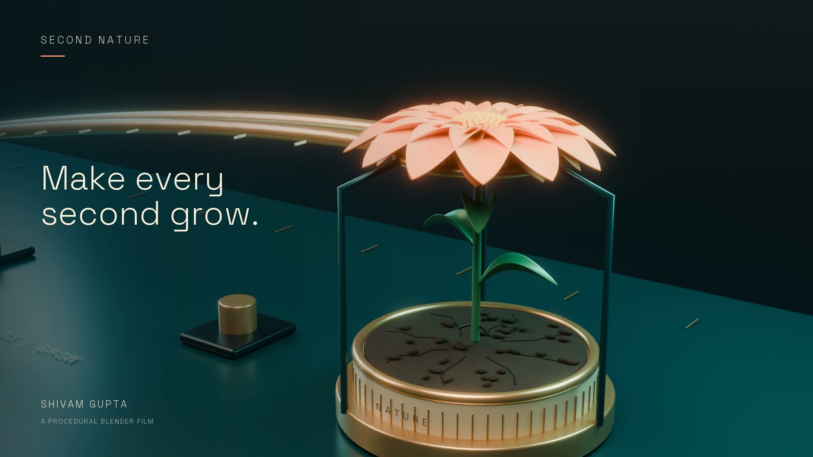

# SECOND NATURE

**Make every second grow.**

A 24-second procedural Blender film and a repeatable production studio by **Shivam Gupta**. One luminous drop races through a precision machine toward a dry seed. Acceleration gives way to a held breath, a fall and a flower.



[Open the studio](https://second-nature-studio.web.app) · [Watch the original 1080p film](film/second-nature.mp4) · [Editable Blender scene](film/second-nature.blend) · [Public source](https://github.com/shi1720/second-nature)

The original film is complete and independently verified: **1920 x 1080, 576 frames, 24 fps, exactly 24 seconds**. **The hosted studio's complete cloud acceptance has also passed:** the Blue hour production rendered all 576 frames at 540p, assembled a 24-second film, played to completion in the authenticated browser and downloaded with the expected SHA-256. Cancellation preserved 17 frames, and the resumed worker reused them. See [testing and publication gates](docs/TESTING.md) and the [accepted cloud report](cloud/qa-report.json). The original, accepted Blue hour palette study and complete 80-second studio guide are now public in the app, without an account or render start.

## Try it in the browser

1. Open [second-nature-studio.web.app](https://second-nature-studio.web.app). The featured original film is ready to watch immediately, without signing in or starting a render.
2. Select **Try the studio** and continue as a guest, or create an email account. Passwords require at least 12 characters.
3. Create a production with a name, drop and enamel colors, and a detail seed. The seed controls soil dressing; the story and camera composition stay fixed.
4. Save it, then select **Create film** when shared capacity is available. This starts the actual Blender build, render and assembly workflow. The workbench shows worker logs and completed frames.
5. Leave the page if needed. The cloud execution continues. Return in the same browser or sign in to the same account to see its state. Budget about 80 minutes for a full CPU render on the current worker; this is an estimate, and actual progress is the source of truth.
6. Once a production finishes, use **Play film**, **Download MP4** or **Blender scene**. Download files you want to keep: generated exports and frame checkpoints are subject to seven-day expiry.

Guest identity persists in this browser's local storage. Use **Keep workspace** while signed in as a guest to link an email account and retain access across devices. Signing out of an unlinked guest account or clearing browser data can lose access to that identity. Hosted accounts are separate from the optional local studio, RenderJuice and Discord.

Cloud previews cover the full story at **960 x 540 and 16 Cycles samples**. The featured original is **1080p and 48 samples**. The current tool varies an authored film system; it does not generate arbitrary stories from a prompt.

## Shared capacity and retention

The deployed application permits **one active production job globally**, with **three render/all starts globally, two per account and two per client network per UTC day**. Limits reset at **00:00 UTC / 05:30 IST**. Failed and cancelled starts count; resuming starts another paid execution and consumes another allowance. The interface reports unavailable capacity instead of pretending a render has started.

Watching the original, preparing a project and downloading an available export do not start a render. No visitor API key or payment is needed. The operator pays cloud costs: these admission limits reduce routine usage, but they are not a hard monetary billing cap. The worker has a two-hour execution timeout and no automatic retries.

Generated files and frame caches expire under a seven-day storage lifecycle; deletion timing is controlled by the storage service. Workspace metadata is retained. A saved production record is not permanent file storage. [Cloud operations and security details](cloud/README.md)

## Architecture

Firebase Hosting serves the frontend, and Firebase Authentication supplies guest and email identities. An authenticated Cloud Run API enforces ownership and dispatches a dedicated Blender worker. A private Cloud Storage bucket holds production metadata, artifacts and fingerprinted checkpoints. Object-generation checks make shared quota and job updates atomic. **There is no Firestore dependency.**

The original film was rendered locally. Studio variants run on the app's cloud workers. No RenderJuice rendering integration or sponsor endorsement is claimed. User exports use owner-authenticated artifact requests; the bucket is not public. A separate, literal three-file public showcase route is implemented for the curated original, Blue hour study and studio guide. The deployed Hosting release points those media URLs to Cloud Run, keeping large movies out of Firebase Hosting transfer. Live checks confirm media headers, bounded Range requests and private-route rejection. This curated showcase grants no public access to user productions.

## Run locally

Use Python 3.10+, [Blender 4.5 LTS](https://www.blender.org/download/lts/4-5/) and [FFmpeg](https://ffmpeg.org/download.html). Python 3.12 dependency versions are recorded in `requirements-lock.txt`.

```sh
python3 -m venv .venv
.venv/bin/python -m pip install -r requirements.txt
.venv/bin/python studio/server.py
```

Open **http://127.0.0.1:8765** and create a separate local account. On macOS, `start-studio.command` performs setup and opens the local studio. Its Python server uses the standard library; NumPy and Pillow support soundtrack synthesis and typography. The local workflow keeps its own files on the workstation.

If Blender is not on PATH, set its executable explicitly:

```sh
export BLENDER_BIN='/Applications/Blender.app/Contents/MacOS/Blender'
.venv/bin/python pipeline.py all --config project.json --profile preview
```

For the palette study configuration, use `--config examples/blue-hour.json`; it writes to a separate project folder. Use `--profile final` for 1080p. Build, render and assemble may also be run separately. A short installation check can render `--start 1 --end 3`; assembly intentionally refuses incomplete sequences. `pipeline.py verify --config project.json` checks build identity and all 576 PNG frames. A complete run can be lengthy on CPU hardware.

Edit `project.json` to change `seed`, `hero_color` and `accent_color`; an optional `output_dir` selects the destination. The local studio puts variants in separate `projects/<id>/` folders. [Local studio instructions](studio/README.md)

## Recovery and verification

- Frames are written atomically. Resume checks dimensions, chunk CRCs and the PNG end marker before reusing them.
- Cache identity includes settings, scene source, renderer source, saved Blender file and quality profile. Modified Blender files require a fresh procedural build before deterministic resume.
- Independent baked camera shots prevent cut-related motion blur contamination. Motion plays without Python autorun, and the font is packed.
- Delivery uses H.264/yuv420p, AAC stereo at 48 kHz and fast-start metadata. Audio is normalized toward -16 LUFS.
- Tests currently pass: **48 Python tests, 44 hosted-state assertions, 9 mocked account-flow scenarios (32 behavior checks), and 14 local progress-parser assertions**. Mocked tests are distinct from real film and cloud acceptance checks.

See [reproducible test commands and acceptance checklist](docs/TESTING.md), [film verification](film/verification.json) and [production quality notes](docs/QUALITY.md). Preserve build/render manifests when resuming. Different GPU backends may produce small pixel differences.

## Craft, credits and supporting materials

Geometry, materials, lighting and motion were created through Blender Python: analytic droplet, rails, gates, machined planter, seed, hinged petals, leaves and Fibonacci pollen. The soundtrack is original mathematical synthesis. Motion is scripted animation, not a physical simulation.

Entrant and project lead: **Shivam Gupta**. OpenAI Codex assisted with concept, code, automation, documentation and review. Space Grotesk is bundled under SIL OFL 1.1. The film contains no stock models, image textures, recorded music or generative video. [Full entry and disclosure](docs/ENTRY.md)

The separate **80-second narrated product demonstration is complete and public in the app**: [watch the guide](https://second-nature-studio.web.app/assets/studio-demo.mp4), [read the script](docs/studio-demo-script.txt) or [inspect its delivery verification](film/studio-demo.verification.json). The 1080p movie passed all eight media checks, including 1,920 decoded frames and an exact 80-second duration. Actual product screens and time-edited production stages accompany neural narration and readable burned captions. The stock synthetic narrator does not clone or impersonate Shivam. [Voiceover provenance and reproduction](docs/VOICEOVER.md)

The [commercial thesis](docs/COMMERCIAL.md) describes a narrow variant-production workflow, proposed pilots and unvalidated assumptions. No customers, revenue or measured time savings are claimed.

**Published and submitted on 21 October 2026.** [Original film on YouTube](https://www.youtube.com/watch?v=folQG-XiqTY) · [Studio guide on YouTube](https://www.youtube.com/watch?v=EePedJF-2lA) · [Official Discord entry](https://discord.com/channels/1547269486057627728/1562304128657522852) · [Submitted Devpost mirror](https://devpost.com/software/second-nature-jrqu9v). The RenderJuice account and private contest registration are confirmed. Both public YouTube videos have published English captions. [Submission receipt and evidence](submission/receipt.json) record these actions; organizer acceptance, eligibility adjudication and awards are not claimed. See [the entry record](docs/ENTRY.md).

## Project map

| Path | Purpose |
| --- | --- |
| `film/second-nature.mp4` | Complete verified original film |
| `film/second-nature.blend` | Editable scene, packed font and baked motion |
| `film/blue-hour-preview.mp4` | Accepted 24-second 540p cloud palette study |
| `film/studio-demo.mp4` | Verified 80-second narrated 1080p studio guide |
| `source/` and `pipeline.py` | Procedural film, synthesis, rendering and delivery tools |
| `web/dist/` | Hosted frontend |
| `cloud/` | Authenticated API, worker, checkpoints and deployment |
| `studio/` | Optional local workstation UI |
| `stills/` | Poster, Blender WIP and production images |
| `docs/` | Testing, submission, commercial and publication materials |

Original project materials: © 2026 Shivam Gupta; see [LICENSE](LICENSE). Font terms: [OFL](assets/fonts/OFL.txt).

## Rebuild the production dossier

The four-page PDF can be rebuilt from the included original stills without the full render cache:

```sh
.venv/bin/python -m pip install -r requirements-docs.txt
.venv/bin/python tools/build_dossier.py
```

The source-only rebuild was exercised separately from the native render-cache build. The final PDF was rendered and visually checked on every page.

## Rebuild and verify the delivery archive

After the original film, cloud variant and captioned demonstration have passed their independent media checks:

```sh
.venv/bin/python tools/package_delivery.py
.venv/bin/python tools/package_delivery.py --verify ../second-nature-submission.zip
```

The packager excludes render caches, virtual environments, local databases and credentials. It refuses unfinished or changed verified media, then checks every archive member against its manifest before publishing the ZIP.
